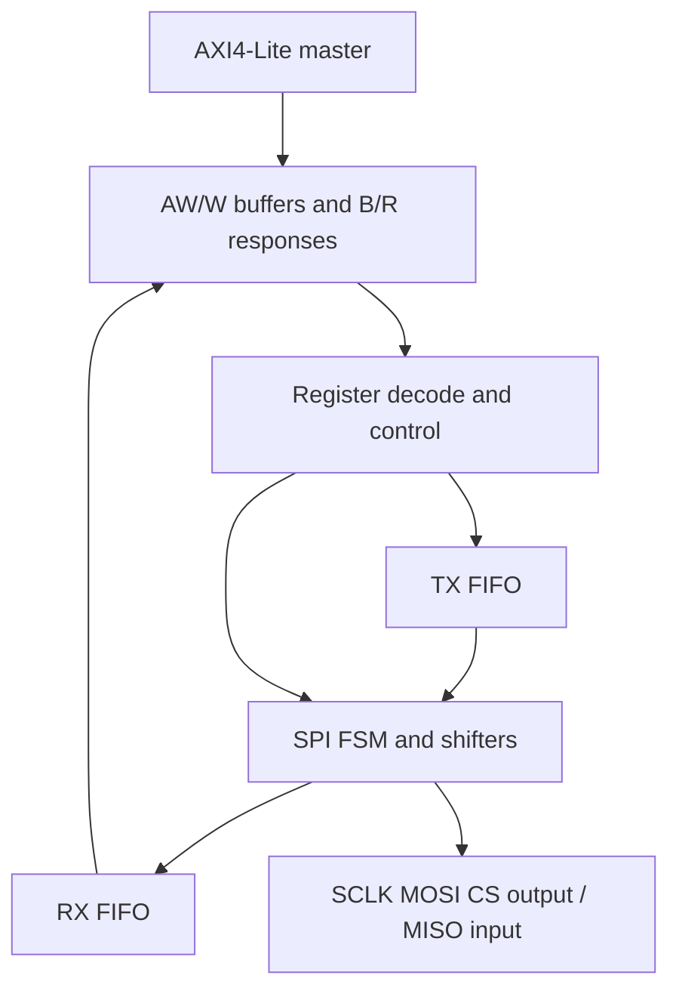

# Specification v1

## Interfaces and behavior

`axi_spi_core` uses one `aclk`, active-low asynchronous `aresetn`; reset release must be synchronized by its integrator (the DE2 wrapper does this). AXI address width 8, data width 32, WSTRB width 4, response width 2. AWPROT/ARPROT accepted and ignored. One outstanding transaction per direction; reads/writes may overlap. AW/W may arrive in either order. Address/data buffered independently; commit once after both accepted. B/R payloads remain stable during backpressure. No AXI bursts, IDs, interrupts, DMA or continuous-CS multi-byte commands in v1.

SPI byte width 8, MSB-first, all four modes. Single clock domain: SCLK is a registered output, not a fabric clock. Config is captured at byte launch. Enable starts queued bytes whenever RX has room. RX-full pauses launch without discarding TX. CS inactive between bytes. For SPI flash commands requiring uninterrupted CS across opcode/address/data, a later extension is required.

| Mode | CPOL | CPHA | Sample edge | Change data edge |
|---|---:|---:|---|---|
| 0 | 0 | 0 | Rising | Falling |
| 1 | 0 | 1 | Falling | Rising |
| 2 | 1 | 0 | Falling | Rising |
| 3 | 1 | 1 | Rising | Falling |

## Registers

| Byte address | Name | Access | Reset | Semantics |
|---|---|---|---|---|
| 0x00 | CTRL | RW | 0 | bit0 enable; bit1 CPOL; bit2 CPHA; others read zero |
| 0x04 | STATUS | RO | 0x14 | bit0 SPI busy; bit1 TX full; bit2 TX empty; bit3 RX full; bit4 RX empty |
| 0x08 | CLKDIV | RW | 25 | Bits15:0 half-period in system cycles; permitted 5–65535 |
| 0x0C | TXDATA | WO | — | Low-byte write enqueues one byte, provided WSTRB[0]=1 |
| 0x10 | RXDATA | RO/pop | — | Returns and removes oldest RX byte; upper 24 bits zero |

Responses: `00` OKAY, `10` SLVERR. Unmapped/misaligned addresses, reading TXDATA, writing RO with nonzero strobes, writing full TX, reading empty RX, changing CTRL/CLKDIV while SPI busy, and divider <5 return SLVERR. Errors have no register/FIFO side effects. RDATA on SLVERR is not meaningful. Zero strobes are OKAY no-op **on mapped addresses**. High-only TXDATA strobes do not enqueue. Divider honors low two byte strobes; CTRL honors low-byte strobe, retains only 3 defined bits.

Full/empty admission uses the state before the active clock edge; a full-TX write can fail even if a byte pops simultaneously. Likewise an empty-RX read can fail even if SPI enqueues that edge. Software polls STATUS/retries as appropriate. A stalled R response does not repeat the pop. Busy excludes FIFO waiting; poll RX-empty for read availability. There is a short completion-to-enqueue interval after BUSY deassertion.

CTRL/CLKDIV accepted on the same edge as a byte launch update the stored configuration; that byte captures the previous values and the next byte uses the updated values. To guarantee configuration applies to the next queued byte, disable launch and configure before queuing/enabling.

## Timing

At 50 MHz, `f_SCLK=50 MHz/(2D)`: D=25 →1 MHz, D=5 →5 MHz. Launch-to-CS-release is `16D+2` clocks; launch-to-RX-FIFO-enqueue is **16D+3** clocks. Continuous launch interval with no stalls is `16D+4` clocks, about 595,238 bytes/s at D=5. These account for registered completion and launch gating; the proposal's 16D+2 RX-enqueue figure was a target and should be corrected in the final report. TB measures 82-cycle completion and 83-cycle enqueue at D=5.

Reset aborts active SPI, clears FIFOs, drops outstanding AXI responses, resets configuration and deasserts CS. The master must discard interrupted transactions and start fresh after reset. FIFO depth >=2; explicit pointer wrap supports non-power-of-two depth. The public SPI engine assumes divider >=5; the AXI core enforces this condition.

## Architecture

DE2 adds an on-chip AXI master to exercise this interface. AXI is internal; switches are demo stimulus, not AXI pins.
